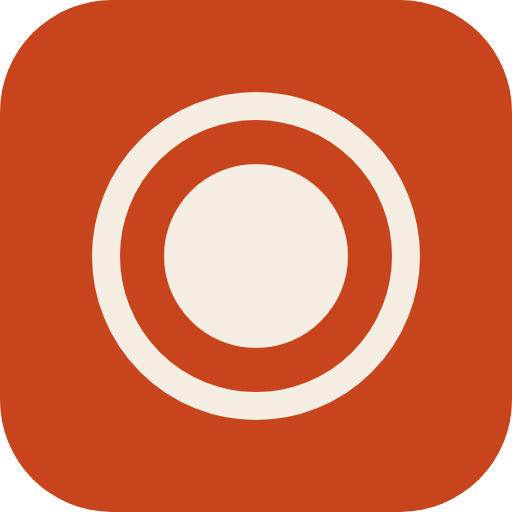
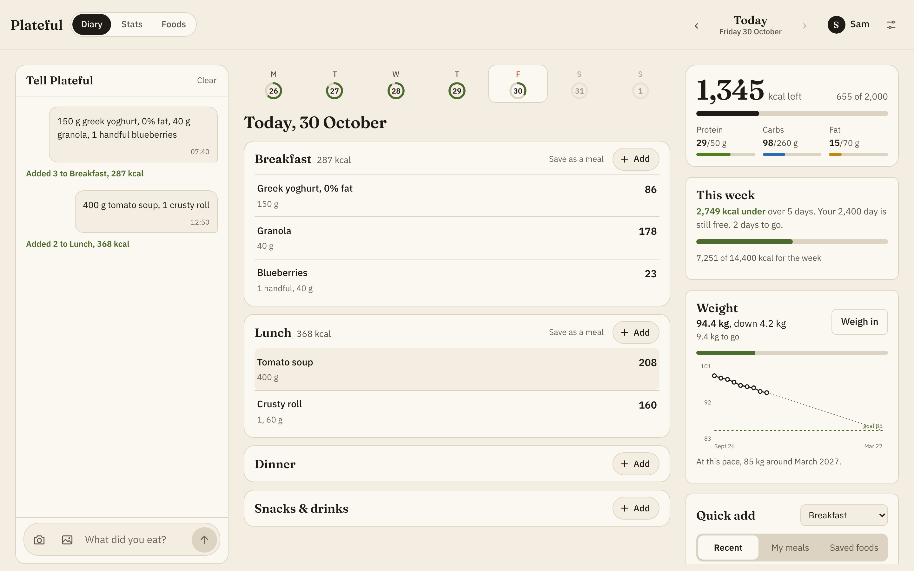
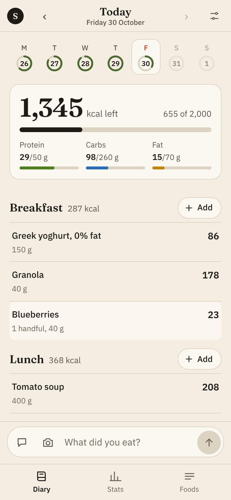
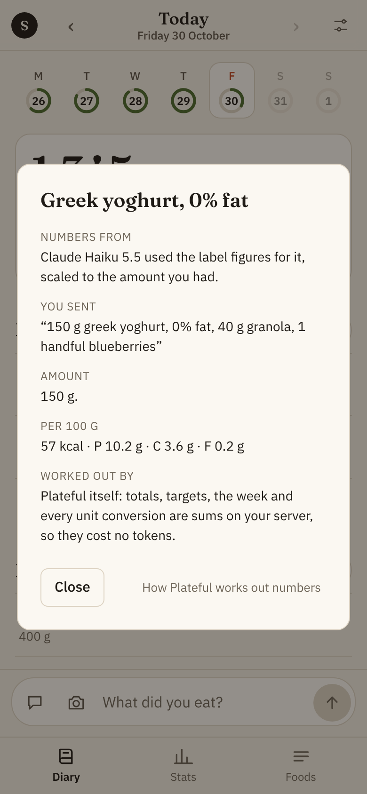
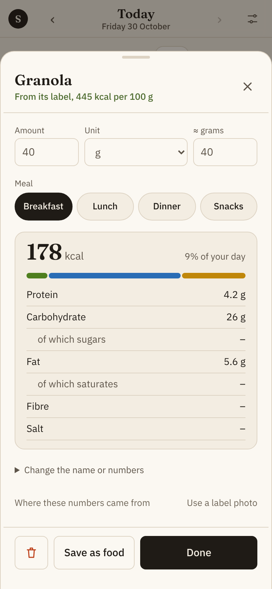
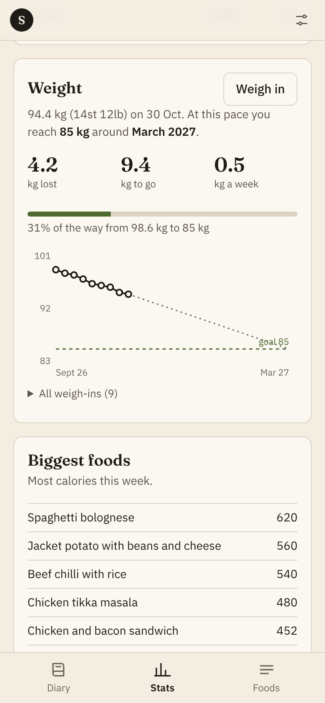
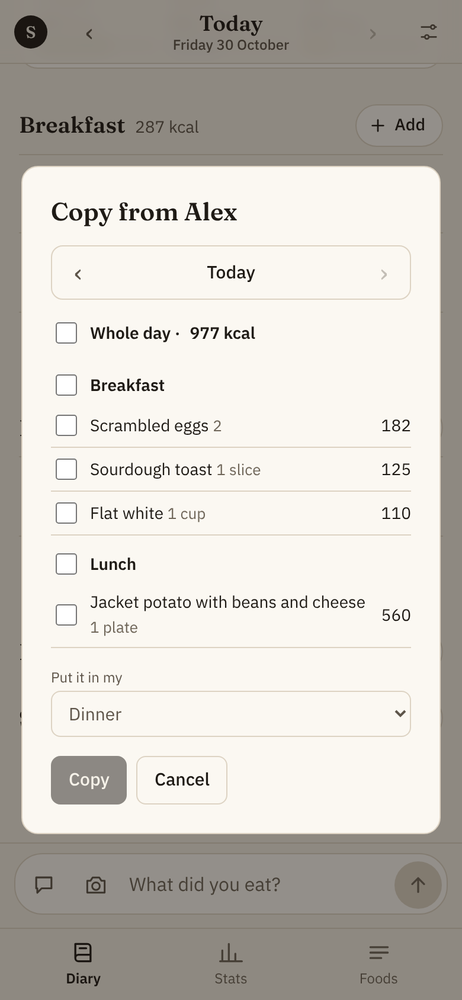
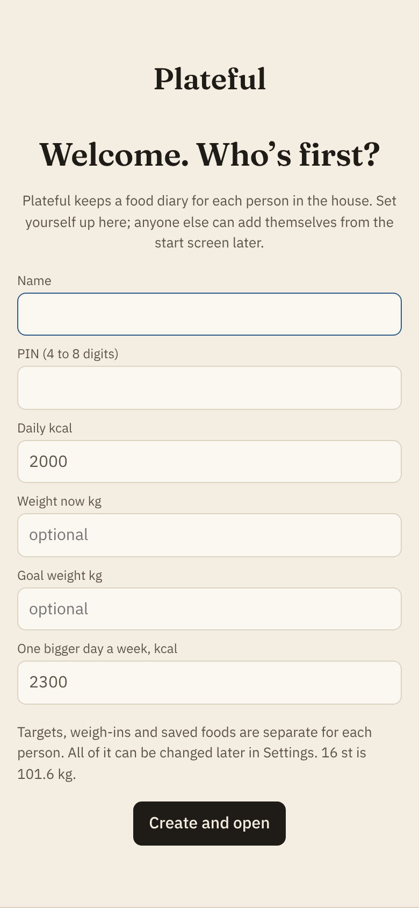
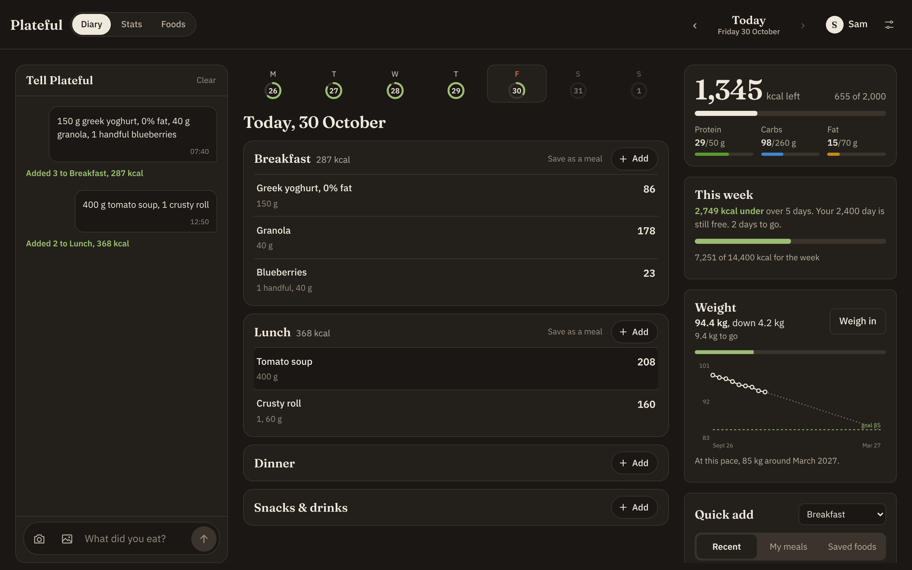

<p align="center">
  
</p>

<h1 align="center">Plateful</h1>

<p align="center">
  <strong>A calorie diary for your household that runs on your own computer. Type, paste or snap what you ate and the AI of your choice turns it into kcal and macros.</strong><br>
  Plateful works out everything else itself, so you only spend tokens when there's food to read.<br>
  Your diary stays on your machine. No account, no ads, no tracking.
</p>

<p align="center">
  <a href="LICENSE"></a>
  
  
  
  
</p>

<p align="center">
  <a href="#quick-start">Quick start</a> ·
  <a href="#why-plateful">Why Plateful</a> ·
  <a href="#features">Features</a> ·
  <a href="#screenshots">Screenshots</a> ·
  <a href="#privacy-what-leaves-your-server">Privacy</a> ·
  <a href="#development">Development</a> ·
  <a href="SETUP.md">Full setup guide</a>
</p>

<p align="center">
  
</p>

---

Most calorie apps want a barcode for everything and a subscription for the useful bits. **With Plateful you write "two crumpets with butter and a tea" or send a photo of a label or your plate, and an AI reads it.** Claude, OpenAI, Gemini, opencode, a model running on your own machine, or any command-line tool you like. Plateful then does the remembering and the maths: daily and weekly targets, a flex day, macros, a weight trend with a goal date, presets and suggestions. The AI is only used at the moment you send something.

## Quick start

You need a computer that stays on (a home server, an old laptop or a small cloud server) with [Docker](https://docs.docker.com/get-docker/) installed, and an AI to read your food: a Claude, ChatGPT or Gemini account or API key, or a local model through Ollama or llama.cpp.

```sh
git clone https://github.com/doolecg/plateful.git plateful
cd plateful
./install.sh
```

The installer asks which AI to use and where you'll use Plateful, then builds and starts it. Open the address it prints, and the first person sets themselves up.

**New to all this?** [SETUP.md](SETUP.md) walks through every step in plain English, including Windows, Tailscale, cloud servers, updating and backups.

## Why Plateful

**Log like you'd text a friend.** "Porridge with a spoon of honey", a photo of a sandwich label, a picture of your plate. The AI reads the label when it can see one, uses your saved foods when they match, and otherwise estimates from typical UK values. Every item is tagged with where its numbers came from.

**Bring your own AI.** Claude Code, OpenAI's Codex CLI, Google's Gemini CLI, opencode (which fronts almost any provider), Ollama, any OpenAI-compatible server such as llama.cpp or LM Studio, or your own command. Each can have one model for typed messages and a stronger one for photos. If yours can't see pictures, Plateful reads the words you sent with them and says so.

**Cheap on tokens.** Typed messages go to the lighter model and photos to the stronger one by default (Claude Haiku and Sonnet out of the box), and each person can change that. Tapping a saved food, a preset or a suggestion, copying from someone else's log, editing amounts and converting units all happen in Plateful itself and cost nothing.

**Built for a household.** Each person gets a profile with a PIN, plus their own targets, weigh-ins and saved foods. You can copy a meal or a whole day from someone else's log when you ate the same thing, and share preset meals between you.

**Yours.** Plateful runs on your machine and keeps everything in one folder (an SQLite file and your photos). Back up the folder and you've backed up the lot.

## Features

- **Text, paste or photograph.** Type a message, paste a screenshot, drop in pictures, or use the camera on your phone. Up to five photos per message.
- **Every unit you could want.** g, kg, oz, lb and stone. Teaspoons, dessertspoons, tablespoons, UK and US cups. ml, litres, fl oz, pints, shots, glasses, mugs, cans and bottles. Slices, handfuls, scoops, bars, portions, bowls and packs. Change the amount and the kcal and macros rescale. Change the unit and the amount converts, so 250 ml of milk becomes 1 cup.
- **Where did that number come from?** The (i) on each item says whether it came from a label, an AI estimate (and which model), a saved food, a preset, someone else's log or your own edit. It also shows the conversion and per-100 g figures.
- **The week, not just the day.** Monday to Sunday bars against your target, with one bigger day a week. That day is either the first one you go over or a fixed day you choose.
- **Weight trend.** Log a weigh-in by typing `w 92.4` or `14st 8lb`. Plateful fits a trend over the last eight weeks and tells you roughly when you'll reach your goal.
- **Presets and suggestions.** Save a meal you have often, or long-press several items and save them as a meal. Plateful suggests your usual breakfast in the morning from your own history, without calling the AI.
- **Installs like an app.** Add it to your phone's home screen. Light and dark themes follow your phone's.
- **Add to any meal in a tap.** Each meal's Add button opens a sheet with what you've had recently, your saved foods and saved meals, and a search box that also takes plain words. If nothing matches, ask the AI, take a photo, or make a new food by hand.
- **A shared food list.** Branded products are looked up in your household's own list first, then on Open Food Facts by barcode or name. A label you photograph is read once and saved per 100 g, so next time it costs no tokens. The Foods page lets you edit, import and export the list as JSON.
- **Camera and paste on any screen.** On a computer the camera buttons open your webcam, and Ctrl+V drops a copied image into whichever photo box is open.
- **Stats.** Calories by day, nutrients against your goals, where the week's calories came from, your biggest foods, weekly averages and the weight trend, laid out to fit a big monitor without scrolling.
- **Your own goals.** Daily kcal plus optional goals for protein, carbs, sugars, fat, saturates, fibre and salt. Anything you leave empty uses the reference intake printed on UK labels.
- **Nine colour schemes**, each in light and dark.
- **Optional household password and HTTPS** for installs on the open internet.

## Screenshots

<p align="center">
  
  
  
  
</p>
<p align="center">
  
  
  
</p>

The people and food in these screenshots are made up. Run `npm run demo` against an empty data folder to get the same demo household.

## How it works

- `src/parse.js` builds the request: your text, any photos (shrunk in the browser first), your saved foods, matching products from the food list and the time of day. It asks for structured JSON back, with each item's amount, unit, weight in grams, kcal, nutrients, brand, barcode and source. It checks the reply against the schema and asks once more, saying what was wrong, if it doesn't fit.
- `src/ai.js` is the only part that talks to an AI. Each provider is a few lines. Claude Code runs as `claude -p` with every tool switched off. Codex runs as `codex exec` in a read-only sandbox with `--output-schema`. Gemini CLI runs in headless JSON mode. opencode uses `opencode run -f`. Ollama goes through its `/api/chat` with a JSON schema. Other servers go through `/chat/completions`. Anything else is a shell command with placeholders.
- `src/fooddb.js` keeps the household food list per 100 g, matches typed amounts of known foods without calling the AI, and looks products up on Open Food Facts.
- `src/server.js` stores entries in SQLite and does all the sums. `src/meals.js` handles presets, copying and the suggestions, and `public/units.js` holds the unit tables shared by the browser and the server.
- The front end is plain JavaScript with no build step, served by the same Express app.

## Privacy: what leaves your server

Plateful has no analytics, tracking or account of its own. It only connects to two outside services: the AI you choose, and Open Food Facts.

- **When you send a message**, Plateful sends that message's text and photos, the names and values of your saved foods and any matching products from the food list, and the local time to your AI, under your own account and that provider's terms. With Ollama or another local server, nothing leaves your network at all. Nothing is sent when you tap saved foods, presets or suggestions, or when you edit, copy or browse.
- **When the AI names a branded product** that isn't in your food list yet, Plateful searches [Open Food Facts](https://world.openfoodfacts.org) (a free, open product database) for its name or barcode. Only the product name, brand or barcode is sent, never your diary.
- **Fonts and scripts** are served by Plateful itself. Pages make no requests to other sites.

Everyone with a profile in your Plateful can see and copy from the other profiles' food logs, but not their weigh-ins or settings. PINs keep a household out of each other's diaries; for anything beyond your home network, set a household password (see [SETUP.md](SETUP.md)).

## Development

Needs Node.js 22.

```sh
npm install
DATA_DIR=./dev-data npm run demo   # optional: a made-up household to play with
DATA_DIR=./dev-data npm start      # http://localhost:8080
```

To read food, set `PLATEFUL_AI` and whatever that AI needs (see `.env.example`), with its CLI on your `PATH` if it has one. Without any, everything except reading new messages still works.

```sh
npm test   # each AI provider against stand-in CLIs and servers
```

## License

Plateful is released under the [MIT License](LICENSE). Copyright © 2026 doolecg.

Claude Code, Codex, Gemini CLI, opencode, Ollama, llama.cpp and the rest are separate software from their own makers, used under your own accounts and their terms. Plateful is not made by, endorsed by or affiliated with Anthropic, OpenAI, Google or any of them; their names are used only to say what Plateful works with.

## Disclaimer

Plateful is a diary, not medical advice. Its numbers are estimates: a label is only as good as the label, and an estimate from a photo of a plate can be out by a fair way, mostly on portion size. Talk to a doctor or dietitian before making big changes to what you eat, especially if you have a medical condition, are pregnant, or take medication that affects appetite or weight.

This software is provided "as is", without warranty of any kind, as set out in the [LICENSE](LICENSE). Back up your `data` folder; you use Plateful at your own risk.
